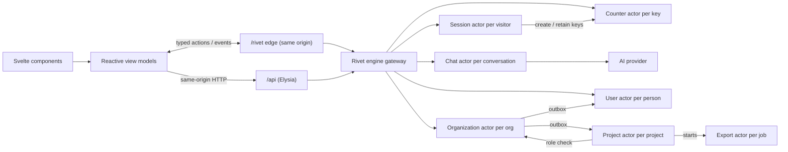

# Architecture and growth

## Ownership

The actor owns business state. The view model owns its browser projection, pending UI state, subscriptions, and cleanup. The component owns rendering and user input. Layouts own the view models their pages share: `routes/data/orgs/[orgId]/+layout.svelte` holds one organization from a signed-in cache, so tabs and projects under it reuse one socket and only the panel re-renders. Components read a snapshot's fields directly; view models apply only newer revisions, and busy or pending looks lag 300 ms so a fast reply changes nothing on screen. While a snapshot loads, a page shows what it already knows (the name and role from the user's index) and skeletons sized like the content, so nothing moves when it arrives. `packages/wire` contains contracts and constants, never credentials or server dependencies. Browser imports of the registry are type-only.

The playground creates one anonymous session actor per browser identity. It persists a bounded registry of up to seven counter keys and labels in its SQLite database; only the random session ID lives in browser storage. Session actions create or attach counters through Rivet's typed actor client, with idempotent creation IDs. Counters retain independent state and receive increments directly. Disconnecting a counter releases a page's socket without removing its registry entry. Removing a counter updates session membership, releases its pooled view model, and broadcasts the change to every tab; it never destroys the independently keyed counter. Undo reattaches the same key and label. An intentionally empty session stays empty on reload. Creation retry history is bounded to the latest 64 IDs. Reload restores all registered counters; other tabs subscribe to registry changes. A session is an index, not an authenticated account or a container that shares counter state.

One Bun server serves the web app, `/api` and `/rivet` on one origin. `/rivet` relays gateway traffic to the engine and denies engine administration, so browsers never see an engine address or token. In production every replica is also an engine node; see [deployment](deployment.md).

## Scale by independent keys

Choose the smallest useful consistency boundary: one room, one conversation, one document, or one job. Multiple API/runner processes can serve many actors; adding processes does not make one hot actor infinitely parallel. Avoid cross-actor fan-out on every token. For aggregate views, build an index or projection rather than scanning every actor.

Use a verified organization/user identity when deriving keys. Never accept a raw user ID as proof; see [access control](#access-control). Cross-actor calls can introduce circular inferred types, so give those action returns explicit types.

## Storage

Every actor keeps its data in its own SQLite database (`c.db`), created by `migrations()` on first wake. RivetKit 3.x deprecates `c.state`, `c.kv`, queues and `connState`; actors created before the move import their old state in their first migration (`packages/actors/src/legacy-state.ts`). `c.vars` holds what should vanish with the process: sessions, timers, presence, abort controllers, a streaming reply between checkpoints. Never put meaningful records there.

The entity actors write through one function, `commit` in `packages/entities/src/store.ts`. A single transaction runs the checks, writes the rows, bumps the revision, appends the audit entry, and reads the new snapshot. The snapshot is published only after the transaction commits, so no client sees a change that rolled back, and views keep the highest revision they have seen. Calls to other actors never run inside a transaction: they are rows in a transactional outbox (`outbox.ts`), committed with the change and delivered after it, with backoff, a cron retry job, and a fresh drain on wake.

Everything that grows has a bound and a way to page: the audit keeps 1,000 entries and the snapshot carries the newest 50 (`getHistory` pages the rest), comments are paged 20 at a time, invitations and exports are capped. Chat keeps a sliding transcript of 40 messages and 64 KiB, measured in serialized UTF-8 bytes, because row count alone cannot bound long Unicode.

The chat stream accumulates in `c.vars`, broadcasts complete content snapshots at most about every 100 ms plus completion, and checkpoints to SQLite at most once a second and at the end. A missed delta is repaired by the next event or reconnect snapshot. A crash can still lose the tokens since the last checkpoint.

[Recipes](recipes.md) maps each of these to its code and tests.

## Work and recovery

A chat action validates and admits one turn in a transaction (busy check, hourly turn budget, pending prompt), then starts the turn under `c.keepAwake`. The actor, not the request, owns generation, so a browser disconnect does not cancel it. A turn still pending when the actor sleeps starts again on wake. `keepAwake` delays idle sleep while the promise is active; it cannot prevent process crashes or forced shutdowns. Turns stop on `turnAbort` (cancel, deadline, or `onSleep`), never on the action's own request signal, which ends as soon as `sendMessage` returns. The chat actor is hosted only when a provider is configured.

This example deliberately does not claim exactly-once model calls, uninterrupted generation across deployments, or crash-resumable streaming. A turn that was streaming when the actor stopped is marked interrupted on wake rather than replayed. This tradeoff keeps the example small and the limits explicit.

For durable multi-step work, use a workflow. The CSV export (`packages/entities/src/actors/project-export.ts`) is the template: a `run: workflow(...)` whose steps are recorded, so a crash or deploy resumes at the step that was running; a `tryStep` that turns exhausted retries into a reported failure; and `sleepUntil` as a durable timer that deletes the file and the actor when it expires. The project is the source of truth: an export actor it does not know deletes itself at the first step.

## Access control

The `/data` browser (organizations, people, projects in `packages/entities`) shows the full pattern. Each actor follows the same four steps, in `src/access.ts`:

1. **Gate the socket.** `onBeforeConnect` verifies the signed principal token in the connection params and checks that this person may open this key at all. A refusal closes the socket once; the client does not retry.
2. **Keep the session in `c.vars`.** `onConnect` stores `{ principal, expiresAt }` by connection id and sets a timer that closes the socket when the token expires. `onDisconnect` clears both. Nothing about the caller is persisted.
3. **Ask again on every call.** Actions read the caller with `caller(c)` (reads) or `writer(c)` (writes, with a per-person budget of 30 then 5 per second), then check the role in the permission table in `contracts.ts`. Roles change while a socket is open, so a gate at connect time is never enough on its own.
4. **Send events only to readers.** Each actor's `store` publishes the committed snapshot through `publishTo(c, canRead)`, which skips anyone whose session has expired or who may no longer read. The user and project actors also refuse subscriptions with `canSubscribe`.

The organization actor keeps no `canSubscribe` check: a refused subscription closes the whole socket, and the client reconnects in a tight loop. Anyone signed in may connect to it, because creating an organization and answering an invitation both happen before membership; its `store` publishes only to current members.

Browsers open organizations, projects and exports with `noCreate`, and actors call each other with `get`, so a guessed key finds nothing instead of starting an empty actor. Only the user actor and the claim of a new organization id create from the browser. The organization checks roles inside its write transaction, so its own changes never commit on a role revoked mid-call. A project asks the organization before it writes; a removal that lands in between is caught by the next call and by `revokeAccess` closing the socket.

Tokens have two kinds. The API signs `user` tokens after sign-in; actors sign 60-second `system` tokens to call each other. Each kind uses its own key, derived from `ENTITY_SECRET`, and the signature covers the kind, so a user token can never pass as the server. The id `system` is reserved: no person can sign in as it or own a key with it. `projectRole`, `canJoin`, `applyProject`, `applyOrganization`, `applyExport`, `exportSource`, `initialize`, `revokeAccess`, `destroy` and a manual `drainOutbox` accept only a system caller.

When someone is removed, the organization commits the change with two outbox rows, retries them until the user and project actors confirm, and each project closes that person's open sockets with `user.access_revoked`. A deleted project closes its sockets with `user.entity_deleted`, then destroys itself; reconnects find no actor and the page reports it gone. An expired token closes with `user.session_expired`; the client fetches a fresh one through `getParams` and reconnects. Do not use the `auth.*` close group: rivetkit treats `auth.token_expired` and `auth.invalid_token` as its own gateway credentials and stops reconnecting.

## Browser lifecycle

Each provider owns its client. Context definitions are module-level; context values are scoped to the component tree. Actors register subscriptions before mounting. Reconnect reads an atomic chat snapshot; events received during the read are buffered and applied afterwards, and a newer status event takes precedence. Old handles cannot populate a newly selected conversation.

The adapter shares/ref-counts matching connections and releases sockets after the final consumer unmounts. Its tests cover credential refresh forwarding, reconnection, action middleware, context isolation, and real Svelte rune execution. These unit tests complement the browser suite; they do not substitute for an actual gateway connection.

## Capacity evidence

No sustained production throughput claim is made by this template. Measure actor count, concurrent sockets, action latency, transaction time, event bytes, memory, SQLite size per actor, outbox depth, provider latency, and reconnect behavior under your expected workload. Test a hot actor separately from many independent actors. Keep local, deployment, persistence, and load evidence distinct.
