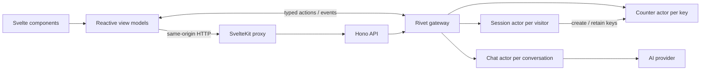

# Architecture and growth

## Ownership

The actor owns business state. The view model owns its browser projection, pending UI state, subscriptions, and cleanup. The component owns rendering and user input. `packages/wire` contains contracts and constants, never credentials or server dependencies. Browser imports of the registry are type-only.

The playground creates one anonymous session actor per browser identity. It persists a bounded registry of up to seven counter keys and labels in `c.state`; only the random session ID lives in browser storage. Session actions create or attach counters through Rivet's typed actor client, with idempotent creation IDs. Counters retain independent state and receive increments directly. Disconnecting a counter releases a page's socket without removing its registry entry. Removing a counter updates session membership, releases its pooled view model, and broadcasts the change to every tab; it never destroys the independently keyed counter. Undo reattaches the same key and label. An intentionally empty session stays empty on reload. Creation retry history is bounded to the latest 64 IDs. Reload restores all registered counters; other tabs subscribe to registry changes. A session is an index, not an authenticated account or a container that shares counter state.

The frontend and API are independently deployable processes. The gateway is a third address, reachable by browsers. Keeping HTTP traffic same-origin avoids coupling the UI to an API host while allowing sockets to connect directly to Rivet.

## Scale by independent keys

Choose the smallest useful consistency boundary: one room, one conversation, one document, or one job. Multiple API/runner processes can serve many actors; adding processes does not make one hot actor infinitely parallel. Avoid cross-actor fan-out on every token. For aggregate views, build an index or projection rather than scanning every actor.

Use a verified organization/user identity when deriving keys. Authenticated connection state can carry identity; never accept a raw user ID as proof. Cross-actor calls can introduce circular inferred types, so give those action returns explicit types.

## Storage budgets

The counter is a good fit for small `c.state`. Chat demonstrates a sliding transcript rather than a permanent archive. Row count alone is insufficient: long Unicode or escaped messages can exceed the state budget, so it also measures serialized UTF-8 bytes. Output and prompt sizes are independently limited.

For full history, use [actor-local SQLite](https://rivet.dev/actors/docs/sqlite/) with schema migrations, a message index, cursor pagination, and an explicit retention policy. Store transient connections, abort controllers, and SDK instances in `c.vars`; never put meaningful durable records there.

The stream accumulates locally, checkpoints bounded content, and broadcasts complete content snapshots at most approximately every 100 ms plus completion. A missed delta can be repaired by the next event or reconnect snapshot. This is a bandwidth improvement over per-token full-text broadcasts, not a guarantee against losing the last unpersisted tokens during a crash.

## Work and recovery

A chat action validates and admits one turn, marks it queued, then sends a durable queue message. The run loop owns generation, so a browser disconnect does not cancel it. `keepAwake` delays idle sleep while the promise is active; it cannot prevent process crashes or forced shutdowns.

Rivet queue messages are removed on receipt. Completing a message is not an automatic retry/visibility-timeout mechanism. This example deliberately does not claim exactly-once model calls, uninterrupted generation across deployments, or crash-resumable streaming. A queued state and enqueue are not one transaction; a crash between them may require starting a new conversation. This tradeoff keeps the example small and the limits explicit.

For production jobs, persist a request ID and progress state, use a durable workflow, make external effects idempotent where possible, and distinguish retryable provider errors from terminal failures. Cancellation itself should be persisted if it must survive restart. Add fault-injection tests for failures before/after enqueue, model acceptance, final checkpoint, and client acknowledgement.

## Browser lifecycle

Each provider owns its client. Context definitions are module-level; context values are scoped to the component tree. Actors register subscriptions before mounting. Reconnect reads an atomic chat snapshot; events received during the read are buffered and applied afterwards, and a newer status event takes precedence. Old handles cannot populate a newly selected conversation.

The adapter shares/ref-counts matching connections and releases sockets after the final consumer unmounts. Its tests cover credential refresh forwarding, reconnection, action middleware, context isolation, and real Svelte rune execution. These unit tests complement the browser suite; they do not substitute for an actual gateway connection.

## Capacity evidence

No sustained production throughput claim is made by this template. Measure actor count, concurrent sockets, queue wait, action latency, event bytes, memory, state checkpoint cost, provider latency, and reconnect behavior under your expected workload. Test a hot actor separately from many independent actors. Keep local, deployment, persistence, and load evidence distinct.
